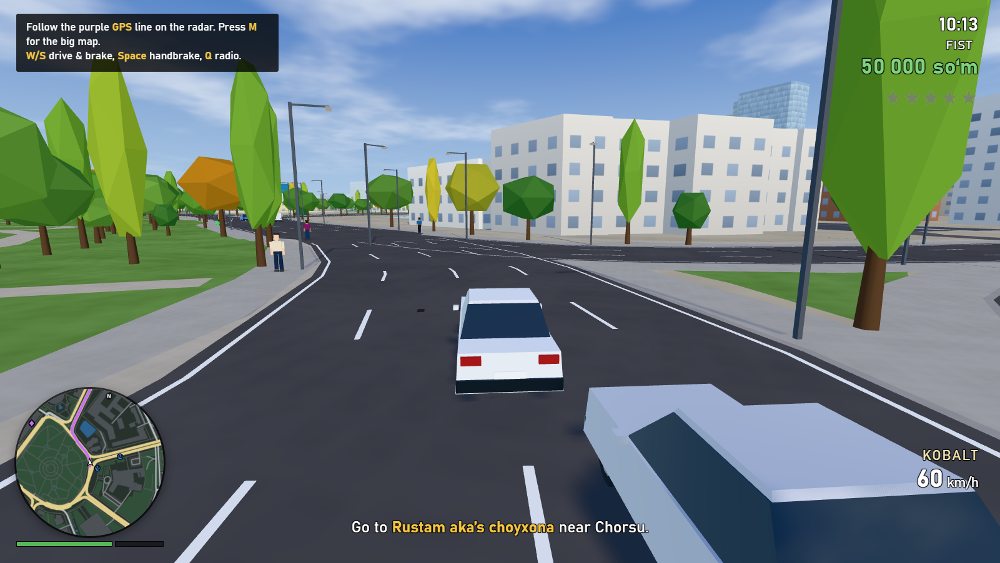
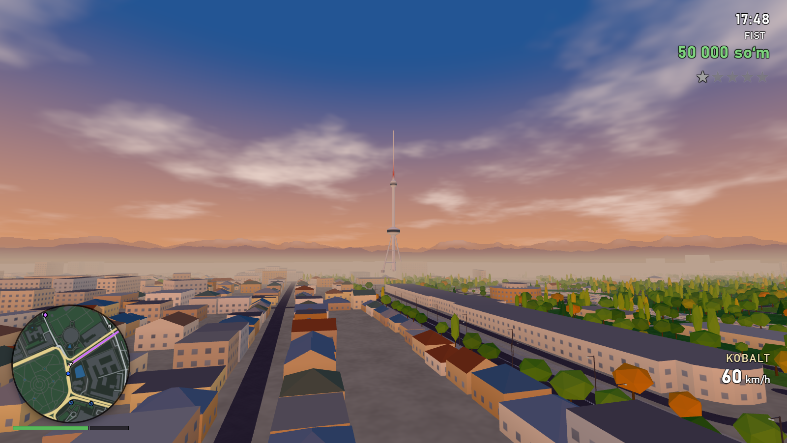
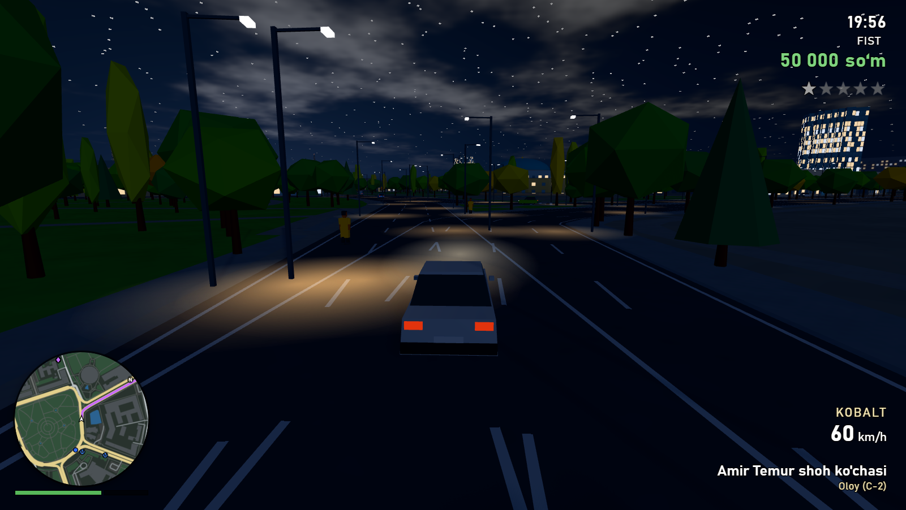
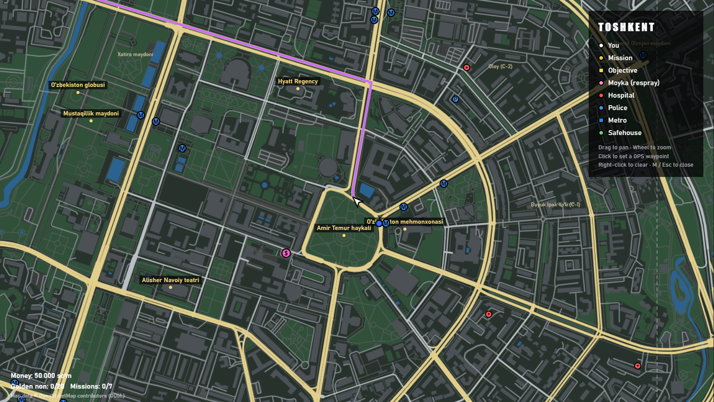
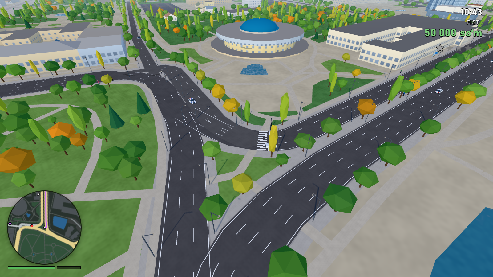

# Grand Theft Avto: Toshkent

An open-world driving and action game in the spirit of GTA, set in the **real streets of Tashkent**.
Every building, street, canal, park, tree, traffic light, bus stop, metro entrance, hospital and police
station comes from OpenStreetMap, so you drive down the real Amir Temur and Navoiy avenues, past
the TV tower, Chorsu bazaar, Minor mosque, Hazrati Imam and the towers of Tashkent City.



## Play

Double-click **`Play.bat`**, or run `dist\ToshkentGTA-win32-x64\ToshkentGTA.exe` directly.
The game opens maximised; press **F11** for fullscreen. Click into the window to capture the mouse.

|  |  |
|---|---|
|  |  |

## What's in it

- **The real city**: about 5.5 x 5.8 km of central Tashkent: 24,674 buildings (real footprints and heights,
  domes, hipped roofs), 13,602 streets with lane markings, 118 junctions with working traffic lights, the
  Anhor and Bo'zsuv canals, parks, 68,000 trees in autumn colours, street lights, bus shelters and blue
  metro "M" signs.
- **Landmarks**: Toshkent teleminorasi (375 m TV tower), the Amir Temur monument, Chorsu dome, Kukeldash
  madrasah, Minor mosque, Hazrati Imam, the Independence globe, Hotel Uzbekistan, Nest One and the Tashkent City towers.
- **Cars**: Kobalt, Neksiya, Lasetti, Gentra, Spark, Matiz, Damas, Labo, Malibu, Treker, city buses,
  taxis, police Malibus and the Samarqand GT. Steal any of them. Arcade physics with drifting,
  crash damage, smoke, fire and explosions.
- **Living streets**: AI traffic drives in lanes, stops at red lights and honks at you; pedestrians
  (some with doppi and headscarves) walk the sidewalks, flee gunfire and sometimes fight back.
- **Police**: wanted stars, patrol cars that chase and ram, officers who arrest (BUSTED) or shoot,
  a helicopter at 4 stars. Break line of sight to lose them, or use a Moyka car wash.
- **Weapons**: fists, pistol, micro SMG, shotgun, AK-47, with drive-by shooting.
- **Day and night**: a full day/night cycle with lit windows, street lamps, headlights, stars and the
  Tian Shan mountains on the horizon.
- **Radio**: procedurally composed music on *Doira FM* (Uzbek folk style) and *Toshkent Pop*.
- **HUD**: rotating radar with GPS route, money in so'm, street and mahalla names, full-screen map with waypoints.

### Story (7 missions with Rustam aka)

1. **Xush kelibsiz**: steal a car and drive to Rustam aka's choyxona near Chorsu.
2. **Issiq palov**: get plov from Besh Qozon by the TV tower to a wedding in Tashkent City before it goes cold.
3. **Marshrutka**: drive the Damas route from Chorsu to Amir Temur square, picking up passengers.
4. **Chorsu o'g'risi**: chase down the thief in the red Matiz.
5. **Politsiya mashinasi**: steal a police car from headquarters and lose the cops.
6. **Tashkent City poygasi**: street race to the TV tower.
7. **Oxirgi ish**: deal with the Qora Ko'zoynak gang.

### Side activities

- **Taxi / marshrutka**: in a Taksi or Damas press **T**, pick up waving passengers and drive them across the city.
- **Moyka** (pink $ on the map): repaint, repair and lose your wanted level for 100,000 so'm.
- **Metro** (blue M): press **E** at an entrance to ride to another station for 2,000 so'm.
- **Oltin non**: find 20 hidden golden breads (50,000 so'm each, 1,000,000 bonus for all).
- **Safehouse** (green H near Minor): press **E** to save. The game also autosaves.

## Controls

| On foot | | In a car | |
|---|---|---|---|
| W A S D | move | W / S | accelerate / brake and reverse |
| Mouse | look | A / D | steer |
| Shift | sprint | Space | handbrake |
| Space | jump | F / Enter | get out |
| F / Enter | enter or steal a car | H | horn (siren in police cars) |
| Left mouse | punch / shoot | Q | next radio station |
| Right mouse | aim | C | camera distance / first person |
| 1-5, wheel | switch weapon | T | taxi / marshrutka job |
| R | reload | Left mouse | drive-by |
| E | metro, save | | |
| C | first / third person | | |

**M** map and GPS waypoint (click the map), **Esc / P** pause, **F11** fullscreen.
An Xbox-style gamepad also works (sticks, RT/LT to drive, Y to enter/exit, RB to shoot).

### Cheats (type during play)

`PULKERAK` +1,000,000 so'm, `SALOMAT` health and armour, `QUROLLAR` all weapons,
`TINCHLIK` clear wanted level, `POLITSIYA` more police, `MOSHINA` spawn a Samarqand GT,
`TUNGI` night, `KUNDUZ` midday.

## Performance

The default *Medium* quality runs on integrated Intel graphics. **Auto resolution** (on by default)
lowers the render resolution when the frame rate drops and raises it again when there is headroom.
In Settings you can switch to *Low* (no shadows, fewer trees) or *High* (real headlights and spotlights,
tree shadows, sharper image), and change draw distance, traffic and pedestrian density.

## How the city was made

The user asked for buildings from Google Maps. Google's terms do not allow extracting building
geometry, and it needs a paid API key, so the city is built from **OpenStreetMap** instead. OSM is free,
open, and has very detailed coverage of Tashkent.

1. `tools/extract-osm.mjs` reads the Geofabrik extract of Uzbekistan
   (`uzbekistan-latest.osm.pbf`) with a small built-in PBF parser and keeps the centre of Tashkent.
2. `tools/build-map.mjs` turns that into `data/tashkent.json`: building footprints, heights, roof
   shapes and styles; road ribbons, lanes and the drivable road graph with traffic signals; water,
   parks, trees, landmarks, hospitals, police stations, car washes, metro entrances and bus stops.
3. The game (three.js + Electron) builds the 3D city from that file when it starts.

## Rebuilding

Requires Node.js 22 or newer.

```bash
npm install
npx install-electron
node tools/extract-osm.mjs path/to/uzbekistan-latest.osm.pbf osm-raw.json
node tools/build-map.mjs osm-raw.json data/tashkent.json
npm start
npm run package
```

`npm run serve` serves the game at http://127.0.0.1:8173 for playing in a browser.

## Credits

- Map data © OpenStreetMap contributors, available under the Open Database License (ODbL).
- [three.js](https://threejs.org) (MIT) and [Electron](https://www.electronjs.org) (MIT).
- A fan-made game; not affiliated with Rockstar Games.
